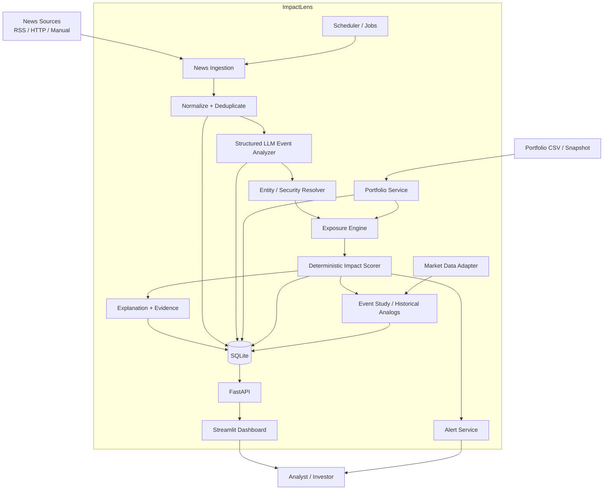
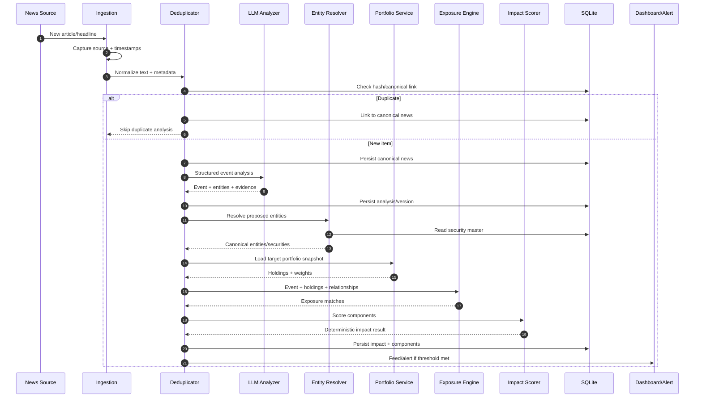
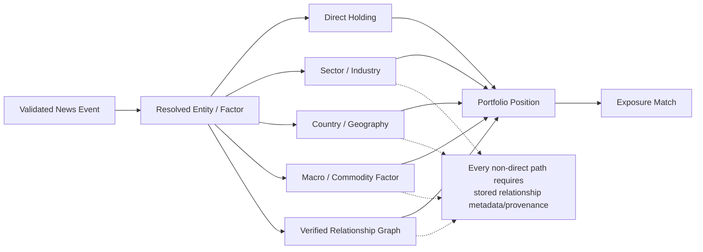
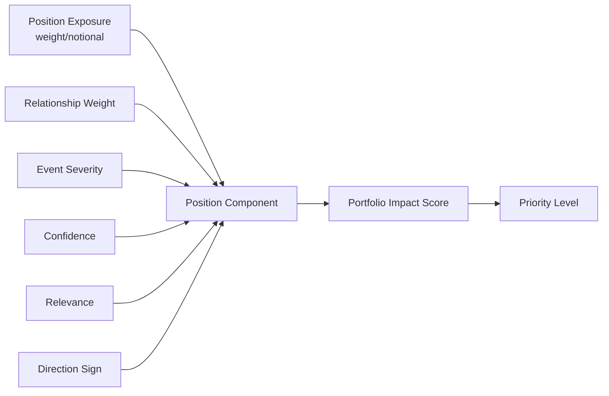
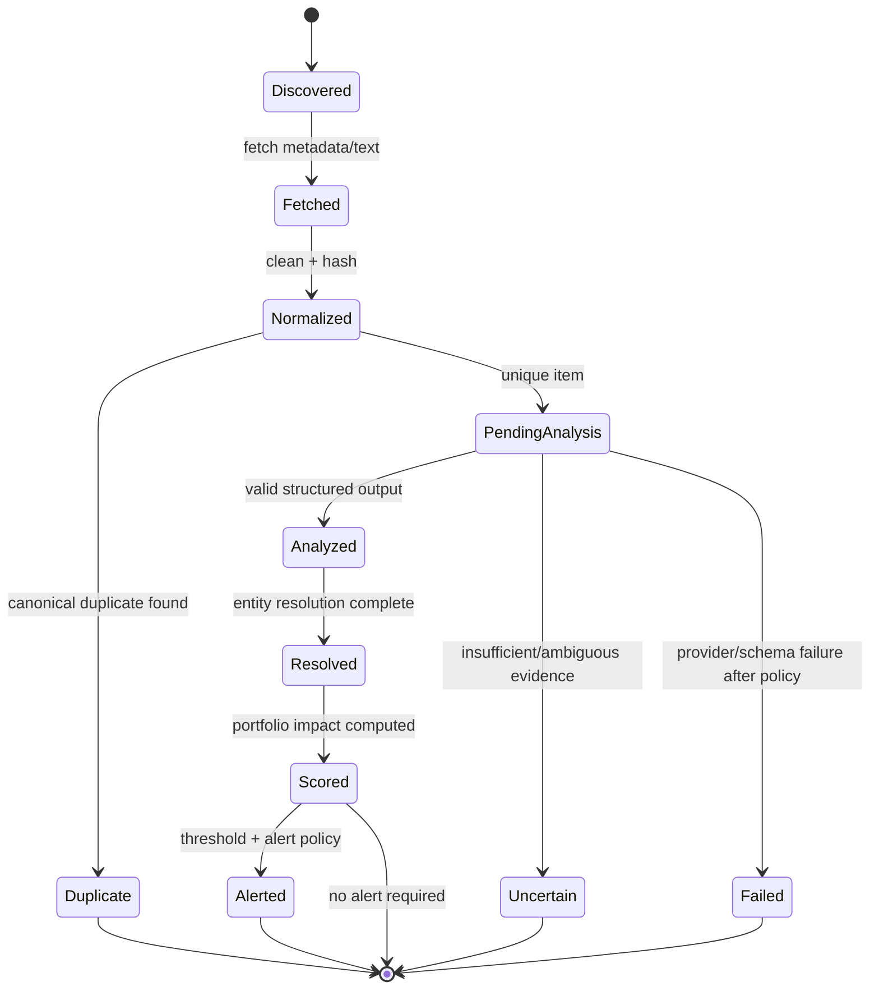
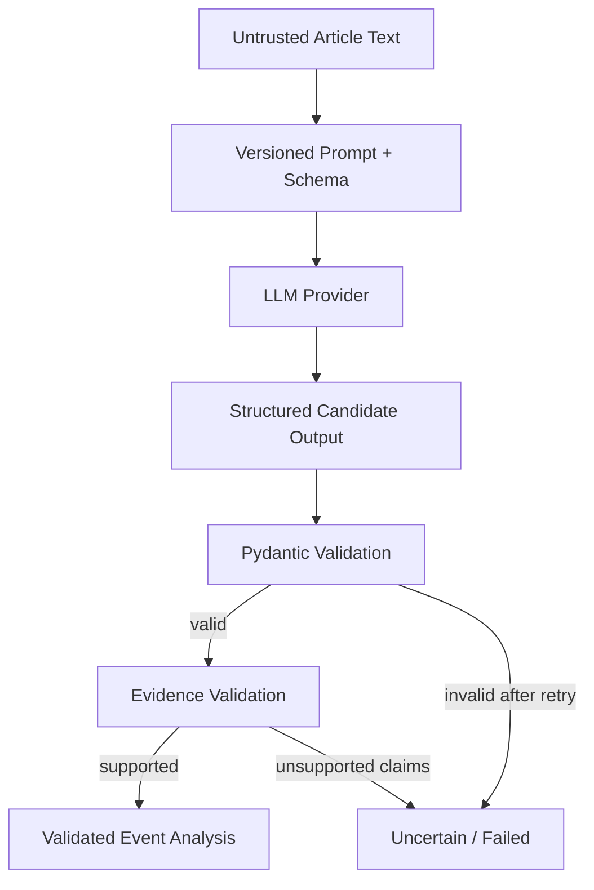
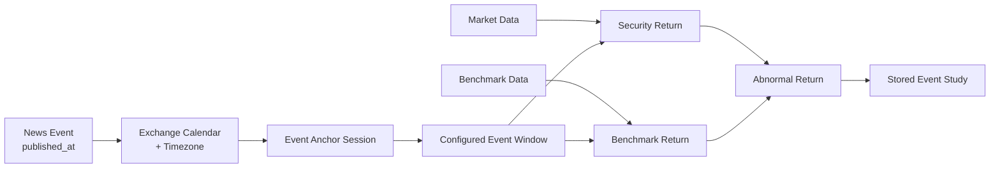
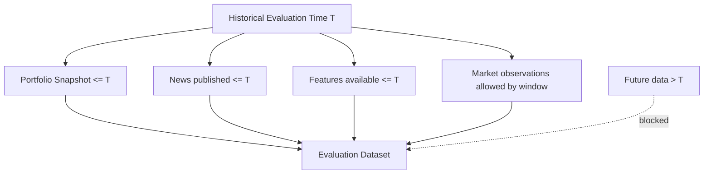
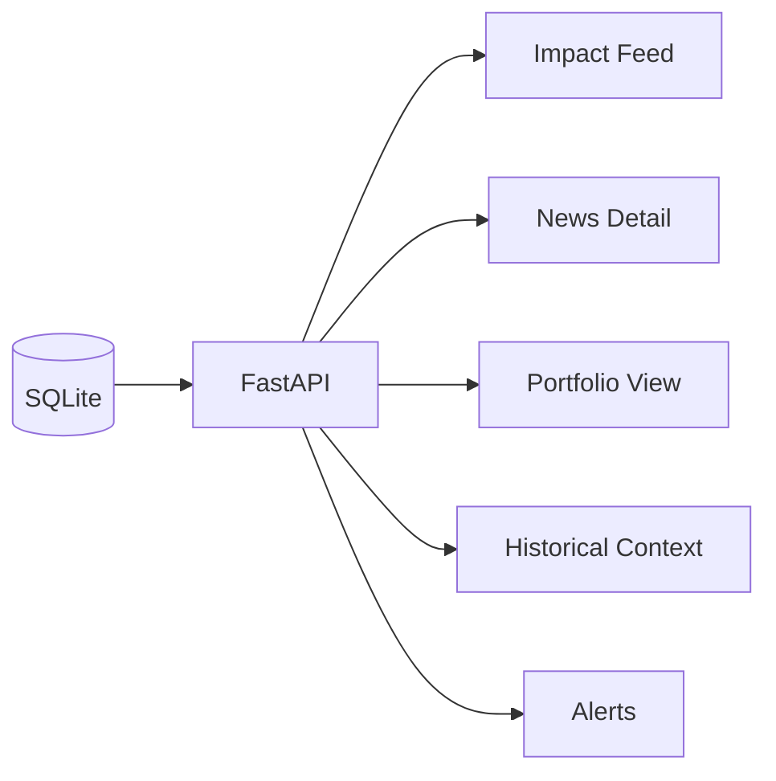
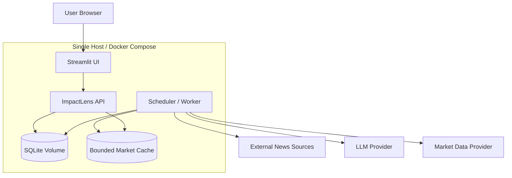

# ImpactLens Diagrams

Mermaid diagrams for **ImpactLens — Financial News → Portfolio Impact Engine**.

**Related documents:** [ARCHITECTURE.md](./ARCHITECTURE.md) · [ROADMAP.md](./ROADMAP.md) · [PHASES.md](./PHASES.md)

---

## 1. System Architecture

---

## 2. End-to-End News Impact Sequence

---

## 3. Portfolio Exposure Mapping

---

## 4. Impact Score Decomposition

Conceptual only. The exact formula is versioned in code/config and must be covered by numerical fixtures.

---

## 5. News Processing State Machine

---

## 6. LLM Analysis Boundary

---

## 7. Historical Event Study Flow

---

## 8. Point-in-Time Guard

---

## 9. Dashboard Information Flow

---

## 10. Deployment Diagram

---

## Diagram Maintenance

- Keep state names aligned with `ARCHITECTURE.md` and implementation.
- Update scoring diagrams when the scoring equation/component model changes.
- Do not add an indirect exposure path without documenting its provenance model.
- Update historical diagrams if event-time/session rules change.
- 2026-10-13: diagrams reviewed against the v1 implementation (state names match `NewsStatus`; deployment matches `docker-compose.yml`).
