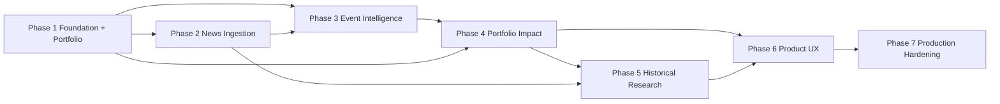

# ImpactLens Implementation Phases

Exhaustive engineering breakdown for **ImpactLens — Financial News → Portfolio Impact Engine**.

Each phase defines **Scope**, **Concrete Deliverables**, **Technical Challenges**, **Definition of Done (DoD)**, and **Automated Test Criteria**.

**Related documents:** [ROADMAP.md](./ROADMAP.md) · [ARCHITECTURE.md](./ARCHITECTURE.md) · [DIAGRAMS.md](./DIAGRAMS.md) · [TASKS.md](./TASKS.md)

**Governing rules:** `CLAUDE.md` and `.claude/rules/*`.

---

## Phase 1 — Foundation, Portfolio Model & Security Master

**Status:** `[x]` Completed  
**Roadmap alignment:** M1 Alpha

### Scope

Establish the Python project, configuration, persistence, immutable portfolio snapshots, and canonical security/entity baseline before live news or LLM analysis is introduced.

### Concrete Deliverables

1. **Project scaffold**
   - Python 3.12+ package under `src/impactlens/`.
   - `pyproject.toml`, pytest, lint/format/type-check hooks as approved.
   - configuration and `.env.example`.
2. **Persistence foundation**
   - SQLite connection/session abstraction.
   - schema migration approach.
   - repositories behind application interfaces.
3. **Portfolio domain**
   - `Portfolio`, `PortfolioSnapshot`, `Position`.
   - immutable snapshot semantics.
   - weight/notional validation.
4. **Portfolio CSV importer**
   - documented template.
   - row-level validation and useful errors.
   - no private real portfolio committed to fixtures.
5. **Security master / resolver baseline**
   - canonical security id, name, ticker, exchange, sector/industry, aliases.
   - explicit ambiguous/unresolved result.

### Technical Challenges

| Challenge | Approach |
|---|---|
| User CSV inconsistency | Validate required columns/types, normalize tickers, fail with row-level errors. |
| Multiple securities with same ticker | Resolve with exchange/country metadata; never silently choose ambiguous matches. |
| Historical reproducibility | Portfolio analysis references immutable snapshot id. |
| Overengineering storage | SQLite + repository abstraction; no distributed database for v1. |

### Definition of Done

- [x] Clean project installs and tests on a fresh environment.
- [x] SQLite schema can initialize/migrate from empty state.
- [x] Sample synthetic portfolio imports into an immutable snapshot.
- [x] Portfolio weight/notional validation is tested.
- [x] Security resolver returns resolved/ambiguous/unresolved outcomes deterministically.
- [x] Secrets/config documentation exists.

### Automated Test Criteria

| Type | Criteria |
|---|---|
| Unit | Position validation and weight/notional calculation fixtures. |
| Unit | CSV header/type/duplicate-position/error handling. |
| Unit | Security aliases and ambiguous ticker cases. |
| Integration | Persist portfolio → snapshot → positions → reload unchanged. |
| Integration | Fresh DB setup/migration smoke test. |

---

## Phase 2 — News Ingestion, Normalization & Deduplication

**Status:** `[x]` Completed  
**Roadmap alignment:** M1 Alpha

### Scope

Create a replaceable news-ingestion layer that captures source provenance, normalizes text/metadata, suppresses duplicates, and produces canonical news records ready for structured analysis.

### Concrete Deliverables

1. **News source adapter contract**
   - provider name/id.
   - fetch cursor/checkpoint.
   - normalized raw item DTO.
2. **At least one automated adapter**
   - RSS/Atom or similarly stable public feed.
3. **Manual ingestion path**
   - pasted text and/or explicit URL ingestion for research/testing.
4. **Normalization**
   - canonical whitespace/title/body.
   - URL canonicalization where safe.
   - timestamp parsing with quality flag.
5. **Deduplication**
   - exact content hash.
   - canonical link/source id checks.
   - optional bounded near-duplicate rule if specified.
6. **Ingestion orchestration**
   - state transitions.
   - retry/error metadata.
   - idempotent provider polling.

### Technical Challenges

| Challenge | Approach |
|---|---|
| Syndicated duplicate articles | Exact hash + source ids/canonical URLs; later optional near-dup. |
| Publication time missing/ambiguous | Store quality enum and retrieval timestamp; never pretend precision. |
| Provider HTML changes | Isolate adapter/parser; fixture tests. |
| Provider rate limits | Bounded concurrency, retry/backoff, adapter-level policies. |
| Article prompt injection | Treat fetched text as untrusted data from the moment it enters pipeline. |

### Definition of Done

- [x] Adapter registry can invoke configured sources.
- [x] At least one real/public feed and a deterministic fixture adapter work. *(RSS/Atom adapter verified with fixture feeds and mocked HTTP; configure a live feed via `NEWS_RSS_FEEDS`.)*
- [x] Manual news ingestion works for local demo/testing.
- [x] Source URL/id, publication/retrieval timestamps, and content hash persist.
- [x] Known duplicate fixtures are suppressed and linked to canonical record.
- [x] Re-polling the same source is idempotent.

### Automated Test Criteria

| Type | Criteria |
|---|---|
| Unit | URL/text normalization fixtures. |
| Unit | Exact duplicate hash cases. |
| Unit | Timestamp parser + quality flags. |
| Contract | Source adapter fake follows common DTO contract. |
| Integration | Source poll → normalized persisted news; second poll adds no duplicate. |

---

## Phase 3 — LLM Financial Event Intelligence & Entity Resolution

**Status:** `[x]` Completed  
**Roadmap alignment:** M2 Beta

### Scope

Transform canonical news text into structured financial events with evidence, then validate mentioned entities against the security/entity master.

### Concrete Deliverables

1. **Financial event taxonomy**
   - event type enum.
   - direction enum.
   - severity scale.
   - confidence range.
   - time-horizon enum.
   - entity roles.
2. **Pydantic analysis schema**
   - event summary.
   - structured entities.
   - evidence spans/sentence refs.
   - uncertainties.
3. **LLM provider abstraction**
   - structured output.
   - retry for transient/malformed responses.
   - model/prompt/schema version capture.
4. **Evidence validator**
   - evidence text must be traceable to the supplied article.
   - reject/uncertain unsupported material claims.
5. **Entity resolver integration**
   - LLM proposes names/roles.
   - resolver maps canonical public securities.
   - ambiguity remains explicit.
6. **Analysis orchestration**
   - `PendingAnalysis → Analyzed / Uncertain / Failed → Resolved`.

### Technical Challenges

| Challenge | Approach |
|---|---|
| Hallucinated tickers | Never trust model ticker; resolve against security master. |
| Hallucinated evidence | Validate evidence against normalized article text. |
| Prompt injection | Strict separation of instructions and untrusted article content. |
| LLM nondeterminism | Structured schema, low-variance settings, versioning, labeled fixtures. |
| Multi-entity direction | Direction stored per affected entity where needed. |

### Definition of Done

- [x] Event taxonomy and schema are documented and versioned.
- [x] Valid structured outputs persist with model/prompt/schema versions.
- [x] Malformed/unsupported outputs route to retry/uncertain policy.
- [x] Evidence used for impact is source-grounded.
- [x] Company mentions resolve to canonical securities or explicit ambiguous/unresolved state.
- [x] Offline labeled fixture evaluation script exists.

### Automated Test Criteria

| Type | Criteria |
|---|---|
| Unit | Valid/malformed/out-of-range structured outputs. |
| Unit | Evidence exact/normalized matching and missing evidence. |
| Unit | Event taxonomy constraints. |
| Unit | Resolver correct/ambiguous/unresolved fixtures. |
| Integration | News record → fake LLM → evidence validation → entity resolution → persisted analysis. |
| Eval | Curated fixture set reports event/entity metrics. |

---

## Phase 4 — Portfolio Exposure Mapping & Deterministic Impact Engine

**Status:** `[x]` Completed  
**Roadmap alignment:** M2 Beta

### Scope

Convert a resolved event into traceable position-level exposure matches and a reproducible portfolio-impact priority score.

### Concrete Deliverables

1. **Direct exposure resolver**
   - exact canonical held-security matches.
2. **Indirect exposure model**
   - sector/industry rules.
   - country/geography rules where supported.
   - commodity/macro mapping table where explicitly configured.
   - provenance-backed relationship graph for supplier/customer/competitor links if added.
3. **ExposureMatch domain model**
   - portfolio position.
   - relationship type/path.
   - relationship provenance.
   - exposure magnitude.
   - relevance/relationship weights.
4. **Impact scoring engine**
   - deterministic versioned formula.
   - signed score + absolute priority.
   - thresholds for impact level.
   - component breakdown.
5. **Explanation composer**
   - source evidence + exposure path + score components.
   - optional LLM prose only after calculations.
6. **Portfolio-impact orchestrator**
   - analysis + portfolio snapshot → persisted impact result.

### Technical Challenges

| Challenge | Approach |
|---|---|
| False indirect relationships | Require stored/provenance-backed relationship or explicit coarse mapping. |
| Score interpretability | Persist every score component and scoring version. |
| Portfolio size dominance | Define/cap exposure normalization explicitly; numerical tests. |
| Mixed events | Position-level direction can differ; aggregate deterministically. |
| Confusing priority with forecast | UI/docs label score as impact priority, not expected return. |

### Definition of Done

- [x] Direct held company in news maps to its position reliably.
- [x] Indirect relationships expose provenance/type and can be disabled/configured.
- [x] Same inputs/config always produce identical score.
- [x] Score decomposition is persisted and shown in result DTO.
- [x] No numerical finance calculation is performed by LLM.
- [x] End-to-end fixture produces ranked affected positions with evidence.

### Automated Test Criteria

| Type | Criteria |
|---|---|
| Unit | Direct exposure matching. |
| Unit | Each supported indirect path with allowed/blocked fixtures. |
| Unit | Hand-calculated impact score examples including caps/thresholds. |
| Unit | Mixed positive/negative component aggregation. |
| Integration | Analyzed news + portfolio snapshot → persisted impact with components. |
| Regression | Scoring version fixture outputs remain stable unless intentionally migrated. |

---

## Phase 5 — Market Data, Event Studies & Historical Analog Validation

**Status:** `[x]` Completed  
**Roadmap alignment:** M3 Release Candidate

### Scope

Add point-in-time historical research so ImpactLens can show observed market reactions to the current event and comparable past events without leaking future data.

### Concrete Deliverables

1. **Market data provider abstraction**
   - normalized price series contract.
   - local cache with source metadata.
2. **Trading-session alignment**
   - exchange timezone/calendar.
   - pre-open/in-session/after-close event policy.
   - non-trading-day behavior.
3. **Event study engine**
   - windows such as `[0,+1]`, `[0,+5]`, configurable.
   - security return.
   - benchmark return.
   - abnormal return.
4. **Historical analog retrieval**
   - similarity using approved event/entity/taxonomy features.
   - no future feature leakage.
5. **Calibration/evaluation**
   - compare impact score buckets with observed absolute/signed reaction.
   - confusion/precision style evaluation where appropriate.
6. **Research output**
   - charts/tables or API DTOs with config/provenance.

### Technical Challenges

| Challenge | Approach |
|---|---|
| After-hours publication | Explicit event anchor policy tested against exchange calendar. |
| Missing prices | Define skip/fallback rules; never silently forward-fill across invalid gaps. |
| Benchmark choice | Configurable benchmark by security/portfolio use case. |
| Look-ahead leakage | Time-filtered features, snapshot cutoff tests, immutable configs. |
| Causal overclaim | Label results as observed reaction/association. |

### Definition of Done

- [x] Market provider is replaceable and tested with fixtures/fake.
- [x] Event timestamp aligns to a documented session anchor.
- [x] Numerical event windows reproduce hand-computed fixtures.
- [x] No-look-ahead guards have dedicated failing/positive tests.
- [x] Historical analog result reveals similarity features and event dates.
- [x] Evaluation report compares score bands to observed reactions without claiming causality.

### Automated Test Criteria

| Type | Criteria |
|---|---|
| Unit | Timezone/session alignment incl. after-close/weekend. |
| Unit | Return and benchmark-adjusted return arithmetic. |
| Unit | Missing-data policies. |
| Unit | Look-ahead violation rejected. |
| Integration | Stored event → market data fake → event study result. |
| Research regression | Fixed historical fixture reproduces same result. |

---

## Phase 6 — API, Dashboard, Alerts & Workflow Automation

**Status:** `[x]` Completed  
**Roadmap alignment:** M4 v1.0

### Scope

Expose the engine as a usable daily research product through API, Streamlit dashboard, scheduled ingestion/analysis, alerts, and research export.

### Concrete Deliverables

1. **FastAPI**
   - portfolios/snapshots.
   - news/analysis.
   - impacts.
   - alerts.
   - historical research.
   - health endpoints.
2. **Streamlit dashboard**
   - portfolio import/view.
   - ranked impact feed.
   - article evidence and event detail.
   - affected positions and score decomposition.
   - historical context.
3. **Alerting**
   - configurable threshold.
   - idempotent/cooldown behavior.
   - initial local/webhook/email adapter only if explicitly implemented.
4. **Job orchestration**
   - scheduled source polling.
   - analyze new unique items.
   - score active portfolio snapshots.
   - failure/retry state.
5. **Export**
   - JSON/CSV and/or Markdown research brief with provenance.
6. **Audit surface**
   - model/prompt/scoring versions visible to user.

### Technical Challenges

| Challenge | Approach |
|---|---|
| Alert spam | Dedup + one canonical news id + threshold/cooldown idempotency. |
| UI business-logic drift | UI calls application/API; no separate scoring. |
| Long-running LLM/provider operations | Jobs/background execution; API returns status. |
| Sensitive portfolio data | Minimal logging; deployment access controls. |

### Definition of Done

- [x] User can import sample portfolio and see current snapshot.
- [x] New unique news can progress through analysis → exposure → score.
- [x] Impact feed ranks items and supports drilldown to evidence/components.
- [x] Historical reaction view works for eligible events.
- [x] High-impact alert fires once under idempotency policy.
- [x] Export contains source and model/scoring version metadata.

### Automated Test Criteria

| Type | Criteria |
|---|---|
| API | Request validation, not-found, pagination/filter behavior. |
| Unit | Alert threshold/idempotency/cooldown. |
| Integration | Job processes unique news and persists impact. |
| E2E | Synthetic portfolio + fixture article → dashboard/API impact result. |
| UI smoke | Critical Streamlit pages start/render under testable smoke path where practical. |

---

## Phase 7 — Hardening, Docker, CI/CD & Operations

**Status:** `[x]` Completed  
**Roadmap alignment:** M5 v1.1

### Scope

Production-minded reliability: E2E regression, observability, containerization, CI/CD, backup/restore, and operational recovery procedures.

### Concrete Deliverables

1. **E2E suite**
   - unique-news happy path.
   - duplicate suppression.
   - uncertain LLM path.
   - unresolved entity path.
   - high-impact alert path.
   - historical event-study path.
2. **Observability**
   - structured logs and correlation ids.
   - `/health` and `/ready` style probes.
   - provider/job error metrics or counters as practical.
3. **Docker/Compose**
   - API, UI, optional scheduler/worker.
   - SQLite persistent volume.
   - cache volume policy.
   - non-root where practical.
4. **CI/CD**
   - install/lint/type/test/security scan.
   - Docker build.
   - tagged release image.
5. **Backup/restore**
   - SQLite snapshot/backup procedure.
   - restore verification.
6. **Operational runbook**
   - provider failures.
   - DB recovery.
   - broken entity resolution.
   - alert storm.
   - LLM schema degradation.

### Technical Challenges

| Challenge | Approach |
|---|---|
| Live-provider flaky tests | Deterministic fakes in CI; optional manual/live smoke. |
| SQLite durability | single-writer discipline, backups, documented restore. |
| Secret leakage | env injection, log scrubbing, CI secret isolation. |
| Provider outage | graceful degraded states and retry/circuit policy. |

### Definition of Done

- [x] Full CI regression suite green. *(All CI steps verified locally; first GitHub Actions run happens on the first push.)*
- [x] Docker Compose starts healthy API/UI and can process a fixture workflow.
- [x] Logs provide correlation across ingestion → analysis → impact.
- [x] SQLite backup and restore drill is documented and tested.
- [x] No secrets or private portfolios exist in repository artifacts.
- [x] Runbook contains actionable incident procedures.

### Automated Test Criteria

| Type | Criteria |
|---|---|
| E2E | Full fixture pipeline, duplicate path, uncertain path, event-study path. |
| Integration | Health/readiness with DB and fake providers. |
| Deployment smoke | Compose services healthy and API reachable. |
| Regression | All prior required tests remain green. |

---

## Cross-Phase Quality Gates

After every task/phase:

1. Required tests are written and passing.
2. `docs/TASKS.md` is updated only after verification.
3. `docs/PROJECT_PHASES_AND_TASKS.md` stays synchronized.
4. Architecture/diagram/config docs are updated when contracts change.
5. No unapproved secret, private portfolio fixture, or unsupported financial claim is introduced.
6. Deterministic finance math remains outside LLM prompts.
7. Historical work preserves point-in-time integrity.

---

## Phase Dependency Graph

